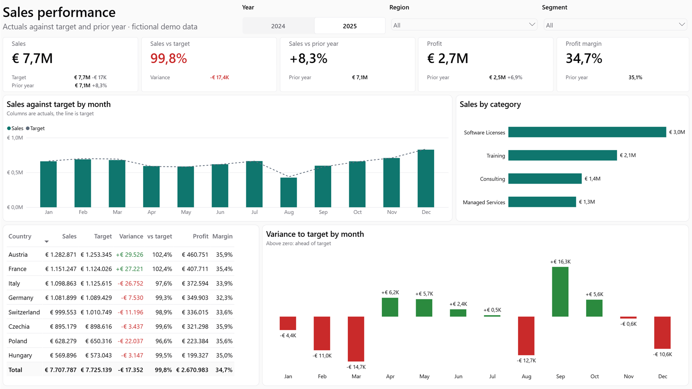
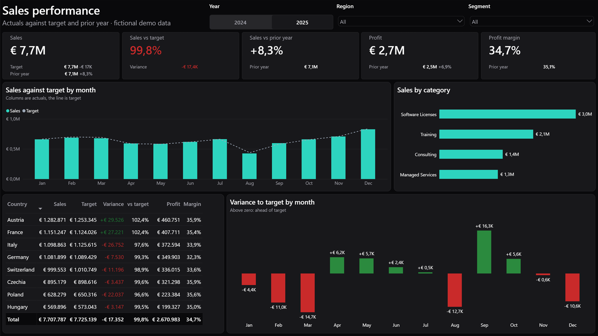
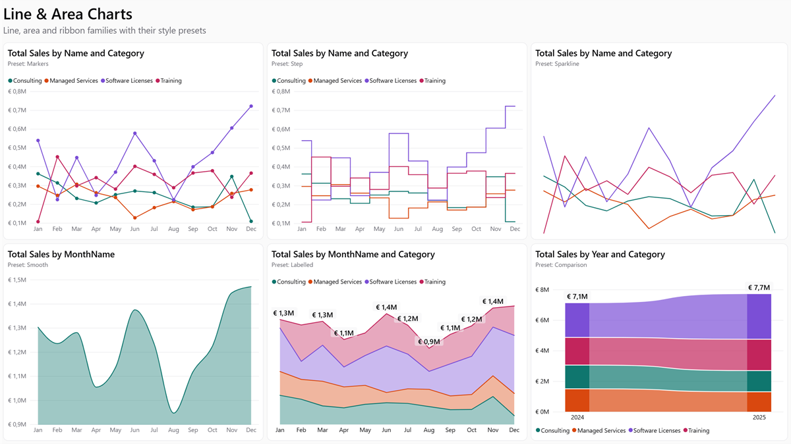
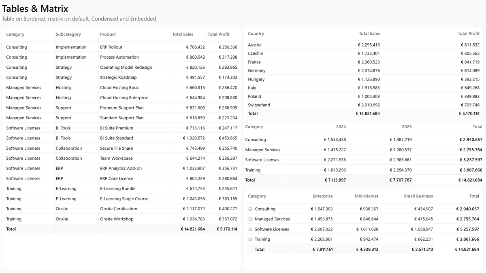
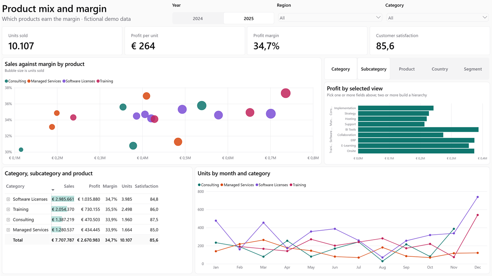

# Sightline

[](https://github.com/itschrishaas/sightline-powerbi-theme/actions/workflows/build.yml)
[](LICENSE)

**An accessible Power BI report theme, light and dark, built from design tokens and checked
by a design linter before it ships.**



- **Every visual type styled**: 45 visual types, the filter pane and the page, from one token file.
- **Accessible by construction**: series colours clear WCAG 3:1 on the canvas and text clears
  4.5:1. The build fails otherwise.
- **Light and dark from the same source**: the dark variant overrides tokens, not templates.
- **Presets with one vocabulary**: `Minimal`, `Labelled`, `Dense`, `Presentation`, `Comparison`
  mean the same on every chart type. Lines add `Markers`, `Smooth`, `Step` and `Sparkline`.
- **A web-app look instead of Power BI defaults**, after [shadcn/ui](https://ui.shadcn.com):
  zinc neutrals, one brand colour, hairline borders, tile slicers drawn as segmented tabs.

The same report on the dark variant, built from the same templates:



## Use it

No build needed. Download [`theme.json`](https://github.com/itschrishaas/sightline-powerbi-theme/releases/latest/download/theme.json) (light) or
[`theme.dark.json`](https://github.com/itschrishaas/sightline-powerbi-theme/releases/latest/download/theme.dark.json) (dark) from the
[latest release](https://github.com/itschrishaas/sightline-powerbi-theme/releases/latest), then in Power BI
Desktop choose **View → Themes → Browse for themes**.

The theme sets a 1920×1080 page. Built and tested against report theme schema 2.159 and
Power BI Desktop 2.159.

### See every visual styled

[`pbi/Preview.pbip`](pbi) is a Power BI project with every visual type and the main presets
on fictional data. Open it in Power BI Desktop and click **Refresh** once, because the data cache
is not in the repo. Clone to a short path: Windows stops at 260 characters, and Desktop then
reports a missing `visual.json` that is actually there.

| Charts | Tables | Slicers |
|---|---|---|
|  |  |  |

## Make it yours

Requires Node.js 22 or later.

```bash
npm install
npm run build
```

Change the colours in [`src/variables.json`](src/variables.json) and their dark values in
[`src/themes/dark.json`](src/themes/dark.json), then build. Both variants pass through two gates:

1. **Schema**: Microsoft's report theme JSON schema.
2. **Design**: WCAG contrast for text and series, a palette without duplicates or semantic
   colours, card edges that read as hairlines, a type scale with real steps.

A theme that fails either gate never reaches `dist/`, and the message names the token, the
measured value and the threshold.

### Edit it with Claude or another agent

[`CLAUDE.md`](CLAUDE.md) (and [`AGENTS.md`](AGENTS.md) for other agents) explains the build loop,
the theme rules and the Power BI traps that pass every check and still do not render. Ask for
*"a light grey header band on tables"* and the agent knows where that goes and how to check it.

## Why not …?

**… edit a theme JSON by hand, or use Power BI's *Customize theme* dialog?**
The dialog covers colours, fonts and a few visual defaults. It has no presets, no per-object
styling and no dark variant. A hand-edited file for 45 visual types runs to thousands of
lines. A light and a dark copy of it drift apart with the first fix.

**… use an online theme generator?**
Generators are good for picking colours. Sightline is about what comes after: contrast that is
checked rather than hoped for, a dark variant from the same source, and presets per chart type.
If you like a generator's palette, put its colours into `src/variables.json` and let the gate
tell you which ones are readable.

**… Style Dictionary or the W3C design-token format?**
The tokens are the small part, about a hundred values in one JSON file. The real work is
mapping them onto Power BI's objects for 45 visual types, and a token pipeline would still need
that mapping. If your organisation already exports tokens, write them into `src/variables.json`.

**… a template engine such as Handlebars, Jsonnet or CUE?**
The templates are plain JSON in which a value can be `"{{token.path}}"`. The resolver keeps
the token's JSON type (numbers stay numbers, colour objects stay objects) and stops on unknown
tokens, cycles and duplicate keys with the file and path. It is about 160 lines in
[`scripts/lib/tokens.js`](scripts/lib/tokens.js), and the only runtime dependency of the
whole build is Ajv for the schema check.

**… put everything in the `*` wildcards?**
Shared objects do live there: the base font in `visualStyles["*"]["*"]["*"]`, and the axes,
legend and container chrome in `visualStyles["*"]["*"]`. A visual file only states what differs.
Data labels stay per visual, because their shared default (`show: false`) would also hide the
labels of treemaps, maps and gauges. The move was checked by comparing screenshots of every
preview page before and after; they were pixel-identical. See
[Wildcards](docs/reference.md#wildcards-what-lives-where).

**… APCA instead of WCAG 2 contrast?**
WCAG 2.x is the standard that accessibility rules such as EN 301 549 and Section 508 point
to. APCA is still a draft for WCAG 3. The thresholds are in one place
(`FLOOR` in `scripts/lint-design.js`) if you need different ones.

**… drop shadows and rounded bars, like the web UIs this is modelled on?**
Power BI renders shadows coarsely and has no corner radius for bars. Cards are separated by a
hairline instead, and the design gate rejects a global shadow.

**… a `.pbix` for the preview?**
A Power BI project (PBIP) is text, so a change to the preview shows up as a readable diff in a
pull request.

## Documentation

- [Documentation site](https://itschrishaas.github.io/sightline-powerbi-theme/): overview, palette, gallery and FAQ.
- [Reference](docs/reference.md): tokens, gates, template syntax, wildcards, every preset,
  known limitations.
- [CLAUDE.md](CLAUDE.md): working rules and Power BI traps, written for agents and useful for people.
- [Changelog](CHANGELOG.md)

## Contributing

Issues and pull requests are welcome. Run `npm run build` before opening a PR; both gates
must pass, and CI checks that `dist/` matches the sources. If a change needs a contrast waiver,
add it to `a11y.waivers` with a reason and explain it in the PR. If it changes how something
looks, attach a before/after screenshot from the preview report.

## License

[MIT](LICENSE)
